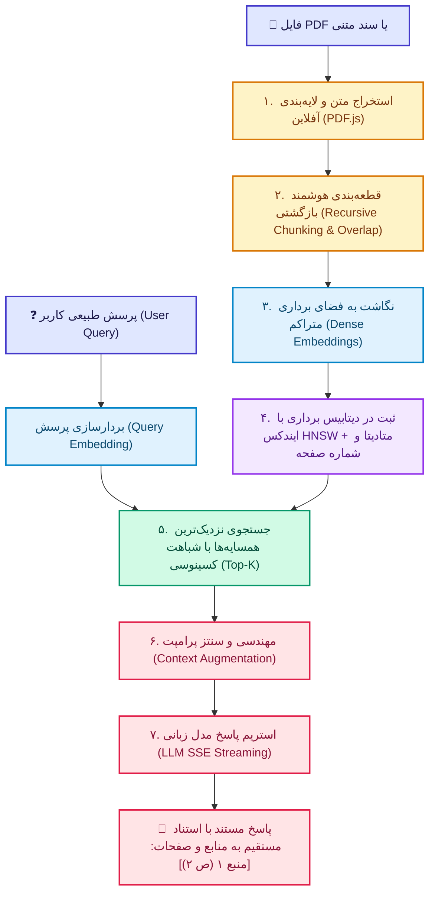

# 🧠 استودیو پیشرفته و بصری RAG (Retrieval-Augmented Generation)

[](https://opensource.org/licenses/MIT)
[](https://github.com/mohamadreza1368/rag_demo)
[](https://www.python.org/)
[](https://developer.mozilla.org/)
[](https://tailwindcss.com/)
[](https://mozilla.github.io/pdf.js/)

> **استودیو بصری، تعاملی و کاملاً عملیاتی RAG**: یک پلتفرم کامل آموزشی و تست عملیاتی برای درک، آزمایش و پیاده‌سازی گام‌به‌گام سیستم‌های **تولید مبتنی بر بازیابی اطلاعات (RAG)** با پشتیبانی از آپلود فایل‌های PDF، محاسبه ریاضی شباهت کسینوسی، تصویرسازی دوبعدی بردارها (PCA Projection) و اتصال زنده به انواع مدل‌های زبانی (OpenAI, DeepSeek, Groq, Ollama و ...).

---

## 📑 فهرست مطالب (Table of Contents)

1. [معماری کلی سیستم (System Architecture)](#-معماری-کلی-سیستم-system-architecture)
2. [آموزش مرحله‌به‌مرحله ارکان RAG](#-آموزش-مرحله‌به‌مرحله-ارکان-rag)
   - [گام ۱: ورود اسناد و استخراج PDF (Ingestion)](#گام-۱-ورود-اسناد-و-استخراج-pdf-document-ingestion)
   - [گام ۲: قطعه‌بندی هوشمند متن (Text Chunking)](#گام-۲-قطعه‌بندی-هوشمند-متن-text-chunking)
   - [گام ۳: تبدیل به بردارهای متراکم (Embeddings & 2D Space)](#گام-۳-تبدیل-به-بردارهای-متراکم-embeddings--2d-space)
   - [گام ۴: پایگاه داده برداری و نمایه (Vector Database & HNSW)](#گام-۴-پایگاه-داده-برداری-و-نمایه-vector-database--hnsw)
   - [گام ۵: جستجو و محاسبه شباهت کسینوسی (Vector Retrieval)](#گام-۵-جستجو-و-محاسبه-شباهت-کسینوسی-vector-retrieval)
   - [گام ۶: سنتز و تلفیق پرامپت (Context Augmentation)](#گام-۶-سنتز-و-تلفیق-پرامپت-context-augmentation)
   - [گام ۷: تولید پاسخ مستند با استناد (Grounded Generation)](#گام-۷-تولید-پاسخ-مستند-با-استناد-grounded-generation)
3. [راهنمای نصب و راه‌اندازی سریع](#-راهنمای-نصب-و-راه‌اندازی-سریع)
4. [راهنمای اتصال به مدل امبدینگ (Google EmbeddingGemma-2)](#-راهنمای-اتصال-به-مدل-امبدینگ-google-embeddinggemma-2)
5. [راهنمای اتصال به ارائه‌دهندگان مدل زبانی (LLM Providers)](#-راهنمای-اتصال-به-ارائه‌دهندگان-مدل-زبانی-llm-providers)
6. [معیارهای ارزیابی سه‌گانه RAG (RAG Triad)](#-معیارهای-ارزیابی-سه‌گانه-rag-rag-triad)
7. [ساختار پروژه](#-ساختار-پروژه)

---

## 🏛 معماری کلی سیستم (System Architecture)

دیاگرام زیر جریان کامل داده را از بارگذاری اولیه سند تا تولید پاسخ زنده نشان می‌دهد:



---

## 📚 آموزش مرحله‌به‌مرحله ارکان RAG

### گام ۱: ورود اسناد و استخراج PDF (Document Ingestion)
در سامانه‌های متداول هوش مصنوعی، مدل‌ها صرفاً به داده‌های زمان آموزش خود دسترسی دارند. برای دسترسی به آیین‌نامه‌ها، مقالات تخصصی، کتاب‌ها و مستندات سازمانی، اولین گام **ورود اسناد خام** است.
- **پردازش ۱۰۰٪ محلی PDF**: استخراج متون صفحات، سرتیترها و پاراگراف‌ها بدون ارسال فایل به سرور خارجی و با حفظ کامل حریم خصوصی.
- **شناسایی صفحات (Page-Tracking)**: حفظ شماره صفحه برای ارجاع دقیق در مراحل بعدی.

### گام ۲: قطعه‌بندی هوشمند متن (Text Chunking)
ارسال کل یک کتاب یا آیین‌نامه ۲۰۰ صفحه‌ای به هوش مصنوعی به سه دلیل غیرممکن یا ناکارآمد است:
1. پر شدن محدودیت طول کانتکست مدل (Context Window Limit).
2. هزینه‌های بالای توکن‌ها و کندی در پاسخ‌دهی.
3. پدیده **Lost in the Middle** (کاهش توجه مدل به اطلاعات وسط متن طولانی).

در این مرحله متن به قطعات استاندارد با دو پارامتر کلیدی تقسیم می‌شود:
- **اندازه قطعه (`Chunk Size`)**: طول متنی هر واحد (مثلاً ۱۸۰ الی ۵۰۰ کاراکتر یا توکن).
- **هم‌پوشانی (`Chunk Overlap`)**: تکرار درصد مشخصی از انتهای هر قطعه در ابتدای قطعه بعدی برای جلوگیری از قطع شدن معنای جملات در مرز قطعات.

### گام ۳: تبدیل به بردارهای متراکم (Embeddings & 2D Space)
الگوریتم‌های ریاضی کلمات متنی را نمی‌فهمند؛ بنابراین هر چانک متنی توسط یک مدل تعبیه (Embedding Model) به دنباله‌ای از اعداد اعشاری در فضای چندبعدی (مثلاً ۳۲، ۷۶۸ یا ۱۵۳۶ بعد) تبدیل می‌شود.
- در این بردارها، جملاتی با مفاهیم نزدیک (مانند «استراحت سالانه پرسنل» و «مرخصی استحقاقی») در زاویه بسیار بسته‌ای نسبت به هم قرار می‌گیرند.
- **نمودار دوبعدی PCA Projection**: با تکنیک کاهش ابعاد (Principal Component Analysis)، بردارها روی یک بوم گرافیکی تعاملی تصویر می‌شوند تا فواصل معنایی به صورت بصری قابل مشاهده باشد.

### گام ۴: پایگاه داده برداری و نمایه (Vector Database & HNSW)
برای جستجوی سریع در میان میلیون‌ها قطعه متنی، از دیتابیس‌های برداری (مانند Chroma, Qdrant, Pinecone, FAISS) استفاده می‌شود.
- **الگوریتم HNSW (Hierarchical Navigable Small World)**: ایجاد یک شبکه گراف لایه‌ای که امکان پیمایش سریع شباهت را با پیچیدگی زمانی $\mathcal{O}(\log N)$ بدون نیاز به اسکن کامل داده‌ها فراهم می‌آورد.
- **فراداده (Metadata)**: هر بردار همراه با اطلاعاتی نظیر نام فایل، شماره صفحه، تاریخ و طول کاراکتر ذخیره می‌شود.

### گام ۵: جستجو و محاسبه شباهت کسینوسی (Vector Retrieval)
هنگامی که کاربر سوالی مطرح می‌کند، پرسش او نیز با همان مدل بردارسازی می‌شود ($V_Q$). سپس میزان شباهت زاویه‌ای آن با تمام چانک‌های ذخیره‌شده ($V_i$) محاسبه می‌شود:

$$\text{Cosine Similarity}(A, B) = \frac{A \cdot B}{\|A\| \|B\|} = \frac{\sum_{i=1}^{n} A_i B_i}{\sqrt{\sum_{i=1}^{n} A_i^2} \sqrt{\sum_{i=1}^{n} B_i^2}}$$

- **Top-K**: برترین چانک‌هایی که بالاترین امتیاز شباهت (مثلاً بالای ۳۰٪ یا ۸۰٪) را دارند سوا می‌شوند.
- در رابط کاربری، خطوط اتصال بردار پرسش به چانک‌های واکشی‌شده در رادار دوبعدی نمایش می‌یابد.

### گام ۶: سنتز و تلفیق پرامپت (Context Augmentation)
در این مرحله هسته اصلی RAG شکل می‌گیرد. یک پرامپت مهندسی‌شده با ساختار زیر ساخته می‌شود:

```
[System Instructions]
شما دستیار رسمی شرکت هستید. صرفاً بر اساس تکه‌های منبع ارائه شده در زیر پاسخ دهید.
اگر پاسخ در منابع نیست اعلام کنید اطلاعاتی ثبت نشده است و هرگز حدس نزنید.
برای هر جمله منبع را با [منبع X (ص Y)] درج کنید.

[Context Chunks]
--- [منبع ۱ | صفحه ۲] ---
{متن چانک بازیابی‌شده اول}

--- [منبع ۲ | صفحه ۴] ---
{متن چانک بازیابی‌شده دوم}

[User Question]
{پرسش صریح کاربر}
```

### گام ۷: تولید پاسخ مستند با استناد (Grounded Generation)
پرامپت غنی‌شده به مدل زبانی بزرگ (LLM) ارسال شده و خروجی به شکل **استریم لحظه‌ای توکن‌ها (SSE)** در رابط کاربری تایپ می‌شود.
- جلوگیری قطعی از توهم (Hallucination).
- استنادهای کلیک‌پذیر به منبع و صفحه: `[منبع ۱ (ص ۲)]` با قابلیت کلیک برای هدایت مستقیم به متن مرجع.

---

## 🚀 راهنمای نصب و راه‌اندازی سریع

### روش ۱: اجرا با Docker Compose روی سرور (پورت 8089 - ویژه سرورها و شبکه سازمانی)
این پروژه به صورت کامل با **Docker** و **Docker Compose** پیکربندی شده و با رجیستری و مخازن میرور داخلی شرکت (`dockerhub.ime.co.ir`, `pypi.repo.ime.co.ir`, `linux.repo.ime.co.ir`, `npm.repo.ime.co.ir`) هماهنگ است.

برای اجرای سرویس روی سرور با **پورت ۸۰۸۹**:

```bash
# ۱. کلون ریپازیتوری
git clone https://github.com/mohamadreza1368/rag_demo.git
cd rag_demo

# ۲. اجرای کانتینر در پس‌زمینه با Docker Compose
docker compose up -d --build
```

پس از بالا آمدن کانتینر، سامانه روی آدرس زیر در دسترس خواهد بود:
👉 **`http://<SERVER_IP>:8089`** (یا `http://localhost:8089`)

#### مدیریت کانتینر:
```bash
# مشاهده لاگ‌ها
docker compose logs -f

# متوقف کردن سرویس
docker compose down
```

> ⚙️ **تنظیمات پورت و متغیرها**: در صورت نیاز به تغییر پورت میزبان یا میرورها، می‌توانید مقادیر را در فایل `.env` تغییر دهید:
> ```ini
> HOST_PORT=8089
> DOCKER_REGISTRY=dockerhub.ime.co.ir/
> PYPI_INDEX=https://pypi.repo.ime.co.ir/repository/pypi-group/simple
> ```

---

### روش ۲: استفاده از سرور پایتون لوکال (با پروکسی ضد-CORS)
پروژه شامل یک اسکریپت سبک پایتونی با پروکسی اختصاصی است که نیازی به نصب کتابخانه جانبی ندارد:

```bash
# کلون کردن ریپازیتوری
git clone https://github.com/mohamadreza1368/rag_demo.git
cd rag_demo

# اجرای سرور
python server.py
```
مرورگر به صورت خودکار با آدرس **`http://localhost:8080`** باز خواهد شد (یا با تنظیم متغیر `PORT=8089 python server.py`).

### روش ۳: اجرای مستقیم در مرورگر
می‌توانید مستقیماً روی فایل `index.html` دوبار کلیک کنید. (برای اتصال به برخی APIهای خارجی بدون محدودیت CORS، استفاده از سرور پایتون یا داکر توصیه می‌شود).

---

## 🧬 راهنمای اتصال به مدل امبدینگ (Google EmbeddingGemma-2)

پروژه به صورت پیش‌فرض و بومی از مدل فوق‌العاده مدرن و قدرتمند **`google/embeddinggemma-2`** (مدل امبدینگ متن گوگل بر پایه Gemma 2) پشتیبانی می‌کند. همچنین می‌توانید از هر مدل امبدینگ استاندارد دیگر در Hugging Face یا به صورت محلی استفاده نمایید.

برای تنظیم مدل امبدینگ، روی آیکون **تنظیمات (⚙️)** کلیک کرده و به بخش **تنظیمات مدل امبدینگ (Embedding Model)** بروید:

### روش ۱: اتصال آنلاین از طریق Hugging Face Inference API (پیش‌فرض)
مدل‌های خانواده Gemma از مدل‌های محافظت‌شده (Gated) گوگل هستند که برای استفاده رایگان از API نیاز به تایید شرایط دارند:
1. وارد حساب کاربری خود در Hugging Face شوید و در صفحه [google/embeddinggemma-2](https://huggingface.co/google/embeddinggemma-2) شرایط کاربری مدل را تایید (Acknowledge) کنید.
2. از بخش [Hugging Face Access Tokens](https://huggingface.co/settings/tokens) یک توکن دسترسی بسازید (`hf_...`).
3. در پنجره تنظیمات برنامه:
   - **سرویس‌دهنده**: `Hugging Face (Inference API)`
   - **نام مدل**: `google/embeddinggemma-2`
   - **توکن دسترسی Hugging Face**: توکن خود (`hf_...`) را وارد کنید.
4. با زدن دکمه «تولید بردارهای معنایی» در گام ۳، تمام چانک‌های متنی به بردارهای متراکم تبدیل خواهند شد.

### روش ۲: اجرای آفلاین روی پایتون محلی (Sentence-Transformers)
اگر کارت گرافیک یا پردازنده مناسب دارید و می‌خواهید به صورت ۱۰۰٪ آفلاین و محلی مدل را اجرا کنید:
1. کتابخانه‌های مورد نیاز را نصب کنید:
   ```bash
   pip install sentence-transformers torch
   ```
2. در پنجره تنظیمات برنامه:
   - **سرویس‌دهنده**: `پایتون محلی (Sentence-Transformers)`
   - **نام مدل**: `google/embeddinggemma-2` یا هر مدل محلی دلخواه نظیر `BAAI/bge-m3` یا `sentence-transformers/all-MiniLM-L6-v2`
3. درخواست‌ها مستقیماً توسط `server.py` به موتور پایتون هدایت و پردازش می‌شوند.

### روش ۳: حالت شبیه‌ساز معنایی آفلاین (بدون نیاز به اینترنت و بدون توکن)
اگر به اینترنت یا توکن دسترسی ندارید:
- **سرویس‌دهنده**: `شبیه‌ساز هوشمند داخلی (Built-in / Offline)`
- سیستم از الگوریتم بردارسازی ۳۲ بعدی محلی استفاده می‌کند و تمامی نمودارهای PCA و جستجوهای کسینوسی دقیقاً مانند محیط واقعی کار خواهند کرد.

---

## 🔌 راهنمای اتصال به ارائه‌دهندگان مدل زبانی (LLM Providers)

روی آیکون چرخ‌دنده **تنظیمات (⚙️)** در بالای صفحه کلیک کنید:

### ۱. اتصال به OpenAI
- **Preset**: روی دکمه OpenAI کلیک کنید.
- **Base URL**: `https://api.openai.com/v1`
- **Model Name**: `gpt-4o-mini` یا `gpt-4o`
- **API Key**: کلید اختصاصی `sk-...`

### ۲. اتصال به Ollama (محلی، آفلاین و کاملاً رایگان)
اگر Ollama روی سیستم شما نصب است، نیازی به اینترنت یا کلید API ندارید:
- **Base URL**: `http://localhost:11434/v1`
- **Model Name**: `llama3`, `qwen2.5`, `mistral` یا مدل دلخواه شما
- **API Key**: خالی بگذارید.

### ۳. اتصال به Groq (فوق‌العاده سریع)
- **Base URL**: `https://api.groq.com/openai/v1`
- **Model Name**: `llama-3.3-70b-versatile`
- **API Key**: کلید دسترسی دریافت شده از کنسول Groq

### ۴. اتصال به DeepSeek
- **Base URL**: `https://api.deepseek.com/v1`
- **Model Name**: `deepseek-chat`
- **API Key**: کلید دسترسی DeepSeek

> 💡 **نکته**: در صورتی که کلید API وارد نکنید، سیستم به صورت هوشمند روی **حالت شبیه‌ساز واقعی (High-Fidelity Simulation)** سوئیچ می‌کند تا بتوانید بدون نیاز به کلید، تمام سازوکار استریم و استناد را تست و ارائه نمایید.

---

## 📊 معیارهای ارزیابی سه‌گانه RAG (RAG Triad)

برای اطمینان از سلامت عملکرد سیستم RAG، سه معیار استاندارد ارزیابی پیاده‌سازی شده است:

| شاخص ارزیابی | مفهوم | نحوه اعتبارسنجی |
| :--- | :--- | :--- |
| **Context Relevance** | چقدر تکه‌های بازیابی‌شده با سوال کاربر مرتبط هستند؟ | مقایسه فاصله برداری و همپوشانی مفاهیم Top-K با کوئری |
| **Groundedness / Faithfulness** | آیا تمام ادعاهای پاسخ در اسناد پایگاه دانش وجود دارند؟ | تطبیق گزاره‌های پاسخ نهایی با جملات چانک‌های منبع |
| **Answer Relevance** | آیا پاسخ دقیقاً به سوال مطرح‌شده جواب داده است؟ | ارزیابی معنایی پاسخ تولیدشده نسبت به درخواست کاربر |

---

## 📁 ساختار پروژه

```
rag_demo/
├── index.html          # استودیو کامل، ریسپانسیو و تعاملی RAG با دیزاین مدرن
├── server.py           # وب‌سرور سبک پایتون با پروکسی ضد-CORS و اندپوینت امبدینگ (/api/embed)
├── Dockerfile          # فایل ساخت ایمیج داکر با پشتیبانی از میرورهای سازمانی
├── docker-compose.yml  # پیکربندی اجرای داکر کامپوز روی پورت 8089
├── .env.example        # نمونه متغیرهای محیطی، پورت‌ها و میرورها
├── requirements.txt    # لیست وابستگی‌های اختیاری پایتون
├── pip.conf            # تنظیمات مخزن داخلی PyPI
├── .npmrc              # تنظیمات رجیستری داخلی npm
├── .dockerignore       # استثناهای ساخت کانتینر داکر
├── tailwind.min.js     # کتابخانه Tailwind CSS نسخه آفلاین و محلی
├── fonts.css           # پیکربندی فونت‌های فارسی و انگلیسی آفلاین
├── fonts/              # فایل‌های فونت Vazirmatn و JetBrains Mono (فرمت woff2)
├── pdf.min.js          # هسته استخراج آفلاین فایل‌های PDF
├── pdf.worker.min.js   # وب‌ورکر پس‌زمینه برای پردازش بدون فریز فایل‌های PDF حجیم
├── package.json        # تنظیمات و اسکریپت‌های پروژه
├── README.md           # راهنمای جامع و مستندات فنی
└── .gitignore          # نادیده گرفتن فایل‌های زائد محیط توسعه
```

---

## 📜 لایسنس

این پروژه تحت مجوز [MIT](LICENSE) به صورت متن‌باز منتشر شده است و استفاده آموزشی و تجاری از آن آزاد می‌باشد.
